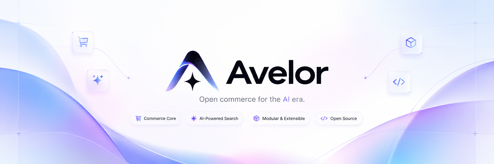

<p align="center">
  
</p>

<p align="center">
  <strong>Open commerce for the AI era.</strong><br />
  A provider-neutral, secure-by-default, open-source commerce engine featuring grounded AI product discovery.
</p>

<p align="center">
  <a href="https://github.com/FazalAttic/avelor-ai/actions/workflows/ci.yml"></a>
  <a href="./LICENSE"></a>
  <a href="https://bun.sh"></a>
  <a href="https://www.typescriptlang.org/"></a>
</p>

---

## Overview

**Avelor AI** is a modular TypeScript commerce platform built around a single core tenet: **the backend is the only source of truth**. 

Unlike generic LLM wrappers that hallucinate prices, fake inventory, or manipulate transactions through untrusted model output, Avelor strictly decouples conversational intelligence from authoritative commerce execution.

- **Universal AI (Bring Your Own LLM):** Plug in any model (Anthropic, OpenAI, Google, Groq, Ollama, etc.) through our neutral `ChatModel` contract or the standard open `ai` SDK adapter.
- **Grounded Discovery:** LLMs only observe what the catalog allows. Tool outputs are deterministic, bounded, and scoped to the active tenant.
- **Transactional Safety:** Minor-unit integer arithmetic (`Money`), zero floating-point math, multi-tenant query boundaries, and idempotent checkout lifecycles.
- **Pragmatic Monolith:** Built with [Ponytail rules](./ponytail.md)—high internal cohesion, clear package boundaries, minimal dependencies, and no premature distributed complexity.

---

## Architecture

```text
               ┌────────────────────────────────────────────────────────┐
               │                   Client Applications                  │
               │         Storefront UI  •  Dashboard  •  Mobile         │
               └───────────────────────────┬────────────────────────────┘
                                           │ HTTP / JSON
                                           ▼
┌───────────────────────────────────────────────────────────────────────────────────────────┐
│                                       @avelor/api                                         │
│                    Hono HTTP Server  •  Tenant & Auth Middleware                          │
└───────────────┬──────────────────────────┬─────────────────────────────┬──────────────────┘
                │                          │                             │
                ▼                          ▼                             ▼
┌───────────────────────────────┐ ┌───────────────────────────┐ ┌───────────────────────────┐
│          @avelor/ai           │ │        @avelor/core       │ │     @avelor/database      │
│ Universal ChatModel Adapter   │ │ Money, Tenants, Catalog,  │ │ PostgreSQL Schema         │
│ DiscoveryAgent & Catalog Tools│ │ Carts, Orders, Calculator │ │ Drizzle ORM Migrations    │
│ Grounded System Prompts       │ │ In-Memory & SQL Repos     │ │ Idempotency Indexes       │
└───────────────────────────────┘ └───────────────────────────┘ └───────────────────────────┘
```

---

## Workspace Structure

The repository is organized as a lightweight Bun monorepo:

| Package / App | Description |
| :--- | :--- |
| [`apps/api`](./apps/api) | Production HTTP API built with Hono. Enforces tenant scoping and exposes catalog, cart, checkout, and AI discovery endpoints. |
| [`packages/core`](./packages/core) | Pure domain logic: integer `Money` arithmetic, `TenantId` branded types, catalog entities, cart calculation, and order state machines. |
| [`packages/ai`](./packages/ai) | Universal AI layer: provider-neutral `ChatModel` contract, open `ai` SDK integration, and grounded tool calling boundaries. |
| [`packages/database`](./packages/database) | Relational database schema and migrations powered by Drizzle ORM and PostgreSQL. |

---

## Universal AI: Bring Your Own Model

Avelor is model-agnostic. You can switch models or providers with zero changes to your commerce logic:

```typescript
import { createAiSdkTools, AiSdkChatModel } from "@avelor/ai";
import { openai } from "@ai-sdk/openai"; // or @ai-sdk/anthropic, @ai-sdk/google, ollama, etc.

// 1. Initialize any LLM via the open AI SDK adapter
const chatModel = new AiSdkChatModel(openai("gpt-4o-mini"));

// 2. Feed grounded, tenant-isolated catalog tools
const tools = createAiSdkTools(catalogRepo, tenantId);

// 3. Run conversational discovery with safe boundaries
const agent = new DiscoveryAgent(chatModel, catalogRepo, tenantId);
const reply = await agent.chat("Find waterproof running shoes under $150");
```

---

## Implementation Roadmap

- [x] **Phase 0: Project Foundation**
  - Bun workspace, strict TypeScript configuration, Biome linter/formatter, GitHub Actions CI.
  - Architecture Decision Records (ADRs) and Ponytail engineering standards.
- [x] **Phase 1: Commerce Foundation**
  - Multi-tenant isolation (`TenantId`), integer minor-unit math (`Money`).
  - Catalog domain (Products, Variants, Inventories, Attributes, Structured Filters).
  - Drizzle PostgreSQL schema and HTTP catalog endpoints (`/api/v1/products`).
- [x] **Phase 2: Universal AI Discovery**
  - Provider-neutral `ChatModel` interface and standard `ai` SDK adapter.
  - Strictly grounded `DiscoveryAgent` with bounded outputs (`search_products`, `get_product_details`).
  - Tenant-isolated discovery endpoint (`POST /api/v1/chat`).
- [x] **Phase 3: Transactions (Carts & Orders)**
  - Server-side minor-unit cart recalculation (`/api/v1/carts`).
  - Atomic inventory reservation and idempotent order checkout (`/api/v1/orders/checkout`).
- [ ] **Phase 3 (Next): Payment Gateway & Webhook Reconciliation**
  - Provider-agnostic payment gateway port and test-mode adapter.
  - Cryptographic HMAC webhook verification (`/api/v1/payments/webhook`).
  - Automated inventory rollback on failed or expired payment sessions.
- [ ] **Phase 4: Extensibility & Storefront**
  - Minimalist, high-performance storefront following the Avelor design standard.
  - Hybrid lexical/vector retrieval and background jobs.

---

## Getting Started

### Prerequisites

- [Bun](https://bun.sh) v1.2+ installed
- Git

### Installation & Verification

```bash
# 1. Clone the repository
git clone https://github.com/avelor-ai/avelor-ai.git
cd avelor-ai

# 2. Copy environment template
cp .env.example .env

# 3. Install workspace dependencies
bun install

# 4. Run typecheck, Biome linter, and full test suite
bun run check
bun test
```

### Starting the API Server

```bash
bun run dev
```

The API will start at `http://localhost:3000`. Test it with a health check:

```bash
curl http://localhost:3000/health
```

---

## Security & Reliability Standards

- **Safe Money Math:** All monetary amounts are handled exclusively in integer minor units (e.g. cents). Floating-point math is strictly rejected at the type and runtime layer.
- **Tenant Isolation:** Every catalog query, cart action, and AI model tool call requires an explicit, verified `x-tenant-id` header.
- **Input Validation:** All HTTP requests and tool parameters are validated at runtime using strict schemas.
- **Idempotency:** Checkout operations require unique idempotency keys to protect against duplicate charging and race conditions.

---

## Documentation

- [Engineering Blueprint v2](./avelor-ai-engineering-blueprint.md)
- [Ponytail Engineering Rules](./ponytail.md)
- [Architecture Decision Records (ADRs)](./docs/decisions/)
- [Contributing Guidelines](./CONTRIBUTING.md)
- [Security Policy](./SECURITY.md)

---

## License

Avelor AI is open-source software licensed under the [Apache License, Version 2.0](./LICENSE).
